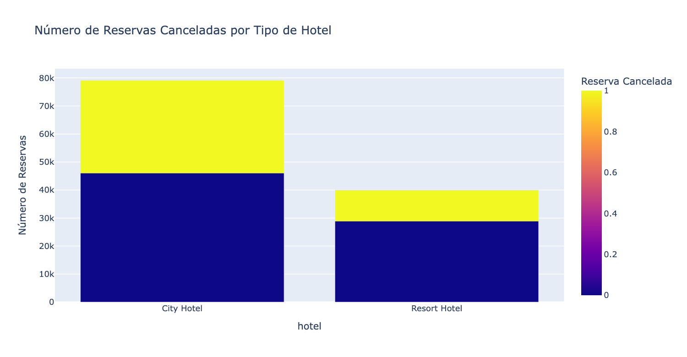
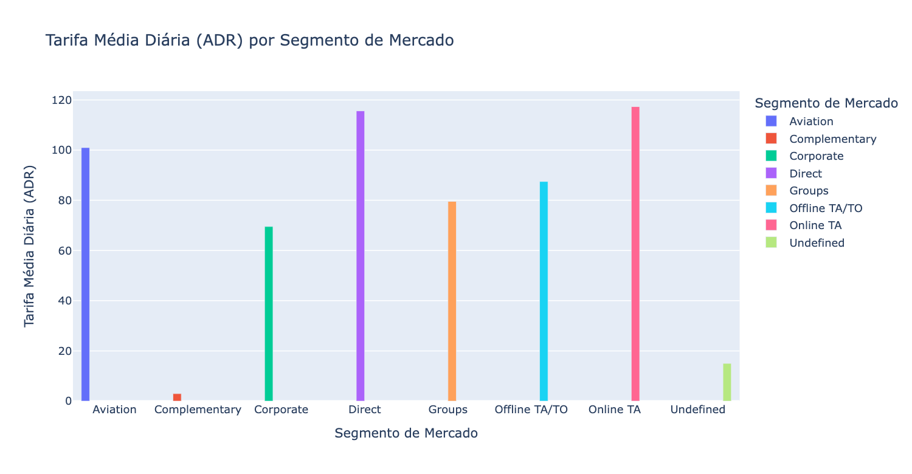
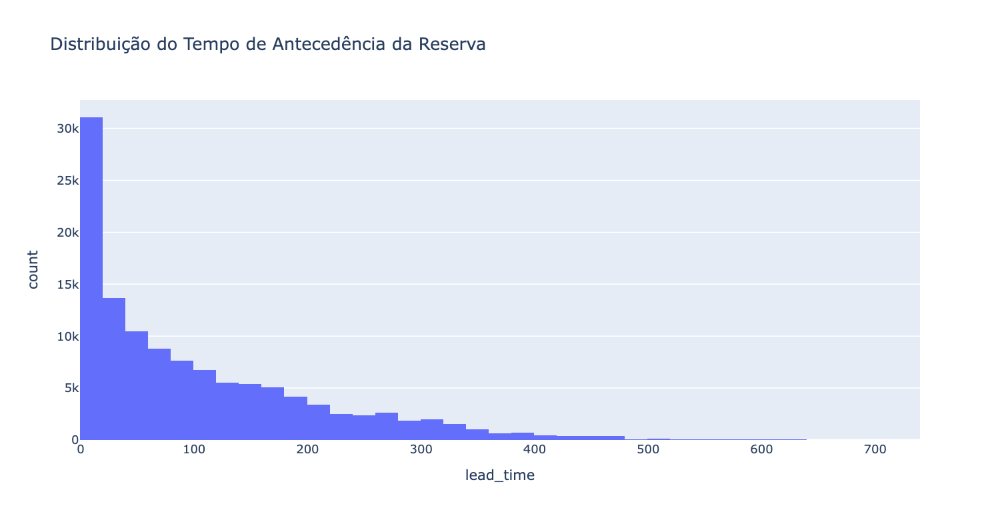

# Projeto-Ciencia-De-Dados

Análise de dados e previsão de **cancelamento de reservas de hotel** com Python e scikit-learn, usando o dataset *Hotel Booking Demand* (Kaggle). Projeto do primeiro bimestre da disciplina de Ciência de Dados.

## Problema

A indústria de hotelaria nos EUA emprega milhões de pessoas no país. Essa indústria foi fortemente afetada por conta da pandemia do COVID-19, durante o início da pandemia a taxa de comércio ativos foi a mais baixa dos últimos três anos, registrando por volta de 38% (Mathews, 2021).

Esse trabalho busca entender e modelar dados do segmento de hotelaria dos Estados Unidos, para determinar estratégias de precificação assertivas e marketing direcionado à determinadas épocas do ano além de entender melhor o comportamento de outras métricas desse segmento, como a taxa diária média (ADR), sua relação com taxa de cancelamento e com outras variáveis.

## Dados

- **Fonte:** [Hotel Booking Demand](https://www.kaggle.com/datasets/jessemostipak/hotel-booking-demand), do Kaggle (Antonio, de Almeida e Nunes, 2019).
- **Tamanho:** 119.390 reservas e 32 colunas, de um hotel urbano (*City Hotel*) e um resort.
- **Alvo:** `is_canceled` (0 = não cancelada, 1 = cancelada). Cerca de **63%** das reservas foram mantidas e **37%** foram canceladas.


## Análise exploratória (EDA)

### Cancelamentos por tipo de hotel

O hotel urbano tem mais reservas e uma taxa de cancelamento maior do que o resort.



### Tarifa média diária (ADR) por segmento de mercado
ADR é a receita total dos quartos dividido pelo numero de quartos ocupados. Esse numero ajuda hotéis a comparar sua performance com outros hotéis no mesmo mercado. No estudo, *Online TA* (agências online) e vendas diretas têm as maiores tarifas.



### Antecedência da reserva (*lead time*)

A maior parte das reservas é feita com pouca antecedência, e a frequência cai conforme o prazo aumenta. Esse padrão é útil para ofertas de última hora.



## Modelagem

- **Escolha do Modelo:** MLP (Multi-layer perceptron), com 100 neurônios na primeira camada oculta e 50 neurônios na segunda camada oculta. O modelo foi treinado com um número máximo de 400 épocas, tambem usamos uma semente para inicializar os pesos do treinamento.
- **Treinamento e Validação:** O modelo foi treinado utilizando o metodo k-fold estratificado, mantendo as proporções dos labels entre as classes.
- **Avaliação do Desempenho:** métricas da rede MLP com K-Fold estratificado

| Métrica | Valor |
|---|---|
| Acurácia | 0,9984 |
| Precisão | 0,9988 |
| Recall | 0,9970 |
| F1-Score | 0,9979 |

## Como executar

O código está em [`mack_ciencia_dados.ipynb`](mack_ciencia_dados.ipynb), feito para o Google Colab ou o Jupyter.

```bash
git clone https://github.com/citricgio/Projeto-Ciencia-De-Dados.git
cd Projeto-Ciencia-De-Dados
pip install kagglehub numpy pandas seaborn plotly folium scikit-learn matplotlib
jupyter notebook mack_ciencia_dados.ipynb
```

## Tecnologias

- Python
- pandas e NumPy
- Plotly, seaborn e folium (visualização)
- scikit-learn

## Estrutura do repositório

```
Projeto-Ciencia-De-Dados/
├── mack_ciencia_dados.ipynb   # análise e modelos
├── imagens/                   # gráficos da análise exploratória
├── Projeto_Primeiro_Bimestre.pdf  # relatório completo do trabalho
└── README.md
```

## Documentação

O trabalho completo, com problema, perguntas da pesquisa, coleta de dados, análise exploratória, modelagem, resultados e conclusão, está no PDF [**Projeto Primeiro Bimestre**](Projeto_Primeiro_Bimestre.pdf).

## Referências

- ANTONIO, N.; DE ALMEIDA, A.; NUNES, L. Hotel booking demand datasets. *Data in Brief*, v. 22, p. 41–49, 2019.
- AMERICAN HOTEL & LODGING ASSOCIATION. *Oxford Economics: Economic Impact of the U.S. Hotel Industry 2019*. [ahla.com](https://www.ahla.com/sites/default/files/oxford2019.pdf)
- MATTHEWS REAL ESTATE INVESTMENT SERVICES. *H2 2023 U.S. Hotel Industry Outlook*. [matthews.com](https://www.matthews.com/h2-2023-u-s-hotel-industry-outlook/)
